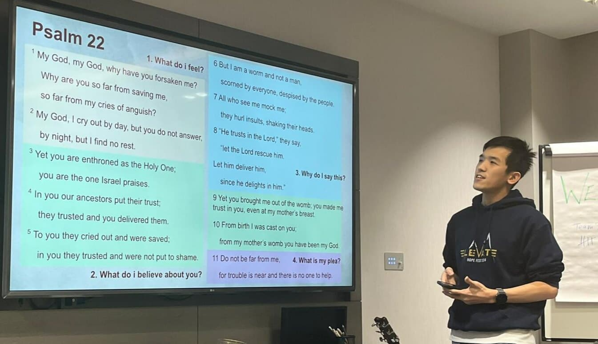
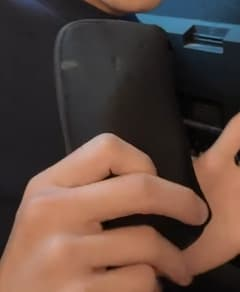
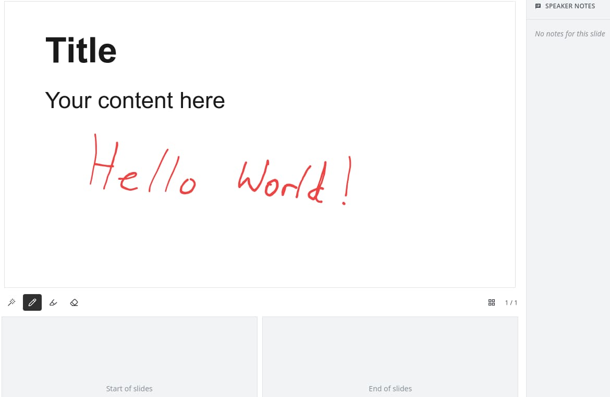

Every week, I travel and teach a youth group. We rent a room with a big screen which is nice, but the best part is that I can use my iPad to control the screen.

It's quite a simple process but it took a while to get here. In the beginning I had to bring my laptop around and set it up once I got there. It gets annoying real quick since I have a million other things to carry. Now, even if I forget my iPad, I can use my phone to do the same.

## The struggle

Recently, I read a post titled [Apple broke an essential presentation feature of iPads](https://teddysvoronos.com/2026-10-19-apple-broke-an-essential-presentation-feature-of-ipads/). They use their iPad to annotate in GoodNotes and AirPlay it to the room. The key part is that everything is seamless to the students. Otherwise, issues become distractions and make the whole teaching process a mess.

In iPadOS 27, tapping any app other than the one presenting hands the external display to that app. This is problematic since it becomes impossible to control what shows on screen. So his students saw his notes and poll results that were not intended to be shown yet.

Reading it, I can relate quite strongly. While I've never properly shared my screen from an iPad (due to the limited resolution & aspect ratio), I've had many such issues due to being the IT person everyone goes to.

## My dream setup

Trying to solve this problem in my own setting, I have some basic requirements & limitations:

- I can't guarantee what the room will have beyond a TV. So it should be flexible
- I want to present Google Slides decks & play music

I experimented with casting but that proved to be quite problematic. Firstly, I can't freely use the iPad due to the issues described above. The iPad also constantly needs to be on and I can't play music easily.

So as any programmer would do, I created a solution for it. The proof of concept started about 3 years ago.

How it works is there are 2 different systems: a **remote** and a **renderer**. They share the same data and the renderer is responsible for turning that data into whatever visual and audio I need.

<figure>
<svg viewBox="0 0 440 236" width="100%" style="max-width: 440px; margin: 0 auto" role="img" aria-label="A server holds the shared data. The remote on an iPad or phone sends changes to it, and the renderer on a TV stick or laptop reads from it" font-family="inherit" fill="currentColor">
  <defs>
    <marker id="arrow" viewBox="0 0 10 10" refX="9" refY="5" markerWidth="7" markerHeight="7" orient="auto-start-reverse">
      <path d="M0 0 L10 5 L0 10 z" fill="#14b8a6" />
    </marker>
  </defs>
  <rect x="145" y="10" width="150" height="66" rx="12" fill="none" stroke="currentColor" stroke-opacity="0.4" stroke-width="2" stroke-dasharray="6 5" />
  <text x="220" y="40" text-anchor="middle" font-size="17" font-weight="700" opacity="0.8">Server</text>
  <text x="220" y="62" text-anchor="middle" font-size="14" opacity="0.6">shared data</text>
  <rect x="10" y="152" width="160" height="76" rx="12" fill="none" stroke="#14b8a6" stroke-width="2.5" />
  <text x="90" y="186" text-anchor="middle" font-size="20" font-weight="800">Remote</text>
  <text x="90" y="210" text-anchor="middle" font-size="14" opacity="0.7">iPad or phone</text>
  <rect x="270" y="152" width="160" height="76" rx="12" fill="none" stroke="#14b8a6" stroke-width="2.5" />
  <text x="350" y="186" text-anchor="middle" font-size="20" font-weight="800">Renderer</text>
  <text x="350" y="210" text-anchor="middle" font-size="14" opacity="0.7">TV stick or laptop</text>
  <path d="M90 150 V114 H200 V80" fill="none" stroke="#14b8a6" stroke-width="2.5" stroke-linejoin="round" marker-end="url(#arrow)" />
  <path d="M240 78 V114 H350 V148" fill="none" stroke="#14b8a6" stroke-width="2.5" stroke-linejoin="round" marker-end="url(#arrow)" />
</svg>
<figcaption>Two separate systems that only talk through the server</figcaption>
</figure>

This data is served by a server so the two can run independently. This means that even if the remote is closed (e.g. the iPad turns off), nothing will change in the renderer.

## The renderer machine

The question then becomes, what should render the visuals?

Well, since I built it on web technologies, pretty much anything that can render a website. Laptops, smart TVs, TV sticks, etc.

So rather than bringing a laptop, I created a Fire TV Stick app and simply bring the stick into my meetings to do all the rendering work. Today, the app is available on many different OSes. And if it's not, you can always just open the browser.

This is all I need to bring to teach, just a pouch with a TV stick:

The best part is, I don't even need to bring my iPad if I don't need it. Controlling it from the phone works just as well.

## Using it day to day

Today, the software ([TheOpenPresenter](https://theopenpresenter.com)) is very reliable. I use it at least twice a week for different meetings. It's open source and you can use it easily. It's easy to import slides, play videos or music, or even show interactive stuff like quizzes or polls.

There are some features to draw on a slide, similar to the workflow in the article I mentioned above. It's still early days in this aspect since I don't use it that often. But I'd be more than happy to accept PRs!

## Try it out

If you ever need to present things and have it be reliable, I recommend you give TheOpenPresenter a try. Beyond making presenting simpler, it also has features to help you prepare easily. Import from Google Slides, PowerPoint, Canva, etc.

You can play YouTube videos or music, show Bible passages, and many more.

The best part is TheOpenPresenter is open source (AGPL). You can try it at [theopenpresenter.com](https://theopenpresenter.com) or read the code on [GitHub](https://github.com/Vija02/TheOpenPresenter). If you want any features added, you can simply create a plugin and it will run immediately!
