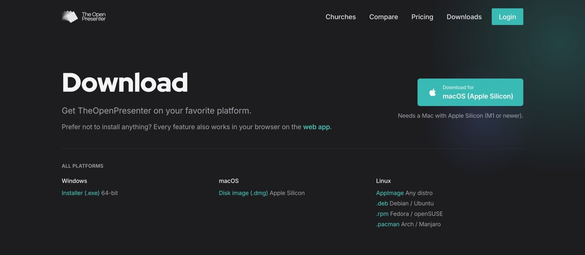
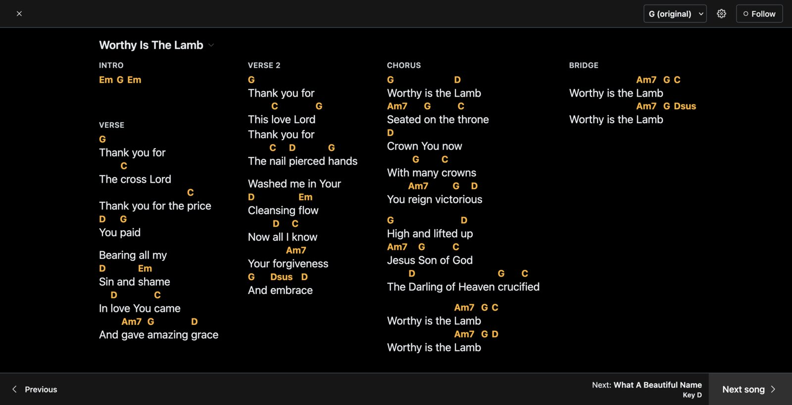
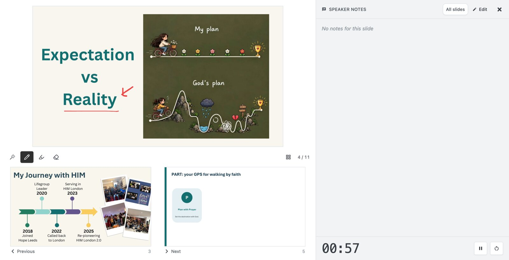
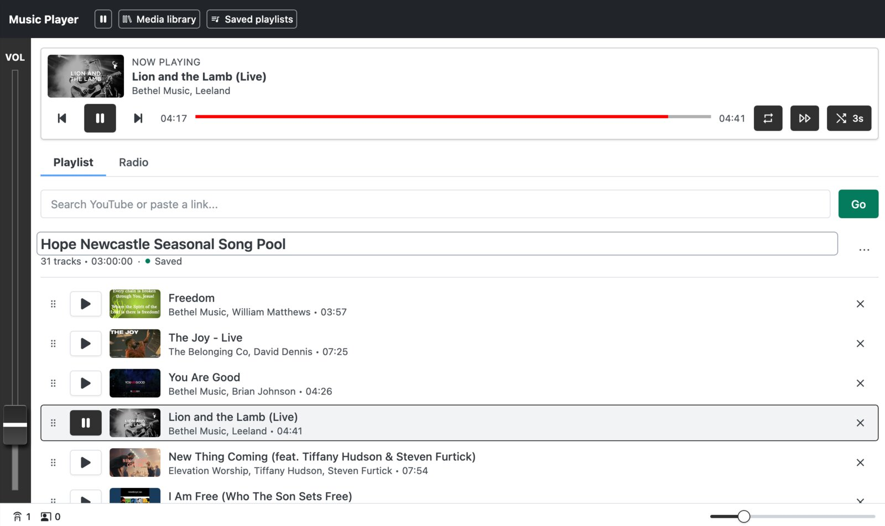
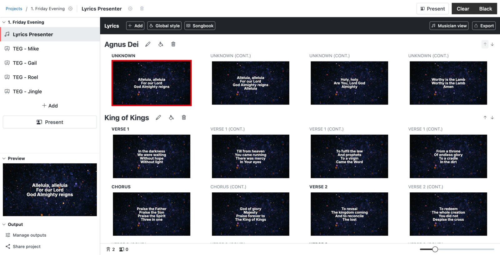
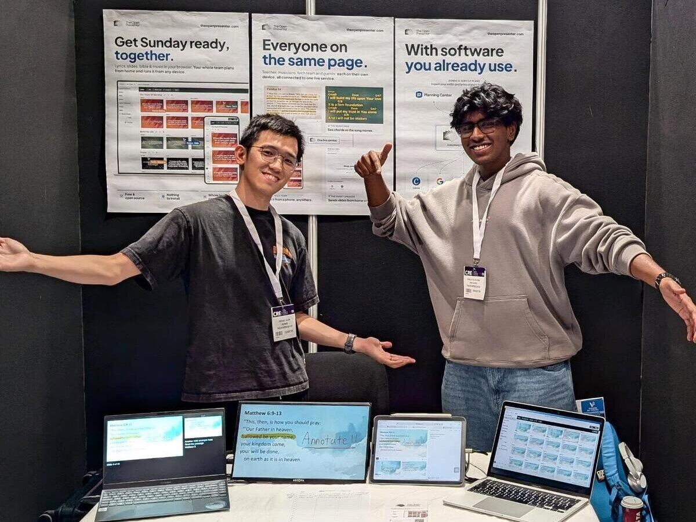

I'm tempted to say October was one of the biggest month we had. But it really was! So let's dive into what changed.

## The new desktop app

The new desktop app is out! You can download it from the [download page](/download) for Windows, macOS and Linux.

*Grab the app for Windows, macOS or Linux*

As previously, it means that you can use it offline and sync it directly from the cloud. Sync is automatic and applies to everything you do in the app.

If you're able to, we now recommend for you to install the app. The web app will always be no 1 priority, but there are some features that are impossible to do in the web app such as NDI. For these, you'll want the desktop app installed.

With the new app, we're resolved some installation issues and made the sync much more reliable. This version moves the mac version from beta to stable!

If you encounter any issues with it, let us know.

## Musician view for your worship team

We also added a view for your worship team. 

There's a new **musician view** in the lyrics plugin. It shows a chord chart for the current song that fits itself to the screen, follows along as you present, and lets each musician **transpose** to whatever key they play in without changing it for anyone else. Pop it on a tablet on a music stand, or put it on a confidence monitor.

*The musician view, with chords laid out to fit the screen*

We also reworked the style engine for lyrics. It now uses the layout engine which allows for full customization compared to the one we had previously. This took a lot of work but it's one of the only plugin left that has not been migrated over.

## Speaker view

We also added a speaker view for pastors. This looks just like how you expect in software like PowerPoint: the current slide, what's coming next, your speaker notes and a timer. 

We improved it by adding **annotation tools.** You can draw on your slides while you present and it shows up live on the screen. Handy for circling a word in a passage or sketching something out.

*Speaker view, with annotations drawn on the live slide*

In the future, we'll add document support so that presenting documents are much easier. This will be useful for a teacher style of teaching.

## Slides: PowerPoint animations & videos

**Full\* PowerPoint compatibility.** PowerPoint files can now be played in a new PowerPoint mode, with their animations, transitions and even Morph, instead of being flattened into still images. No need to worry about animation not working anymore!
\* If it runs on PowerPoint web, it will run here. In practice, unless you're doing complex things, it will work.

**Videos in your slides.** Videos in PowerPoint and in Google Slides now play as expected. No need to swap between different software anymore.

## The music player plugin upgrade

Now, a change that has been long due. The radio plugin has grown into a full music player.

Build playlists with crossfade between tracks, upload your own audio, or paste in a YouTube playlist. Already have a playlist on Spotify? Import it and we'll find each song for you. Playlists are saved, so your pre-service playlist is ready to go every week.

*New music player with a saved playlist*

The video player got a rework too, with queuing videos one after another and adjustable playback speed.

## ChurchSuite integration

Following Planning Center last month, you can now connect **ChurchSuite** and import your setlists straight into the lyrics plugin. Same as before, songs are matched against the ones you already have so you don't end up with duplicates.

## Quality of life changes

There's so so much more to be mentioned. October was huge. Here's some more notable ones:

**Sidebar rework.** The sidebar now houses a live preview panel. We hope this will make it easier to understand what is going on. Separately, we also updated how it looks on smaller phones to make it more user friendly.

*The reworked sidebar with its live preview panel*

**Bible styles global style.** Style your Bible passages once and it applies everywhere instead of setting it up in every project.

**Faster images ⚡.** Images are now served in WebP where your device supports it so they load quicker.

**Persist slide login.** Google Slides and Canva now remember your login, so you only have to connect your account once instead of signing in every time you import a deck.

## We were at CRE!

In October, we exhibited at CRE, the Christian Resources Exhibition. Thank you to everyone who stopped by our stand!

It was great to talk to so many churches and hear about how they actually run their services. Hearing what works, what doesn't and what people really need has already shaped what we're building next.

If you missed us there, send us a message and we'll give you a few free months of our cloud plan.

As always, if there's something you'd like to see, let us know!
